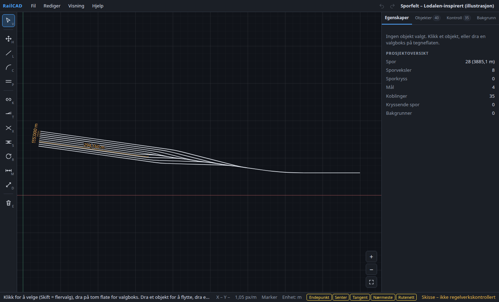
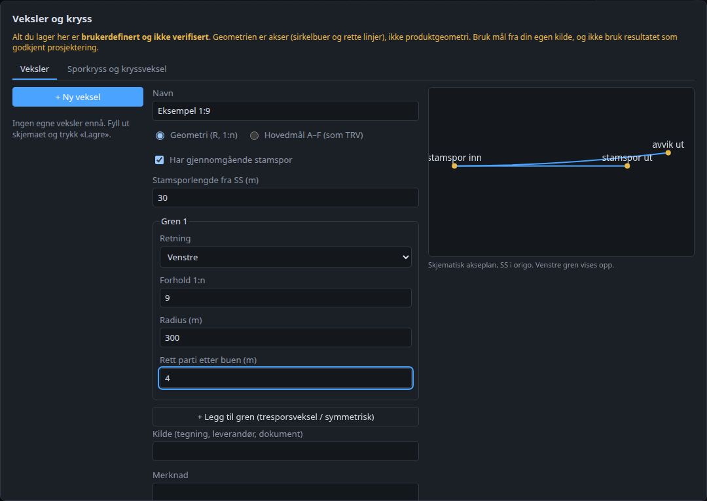
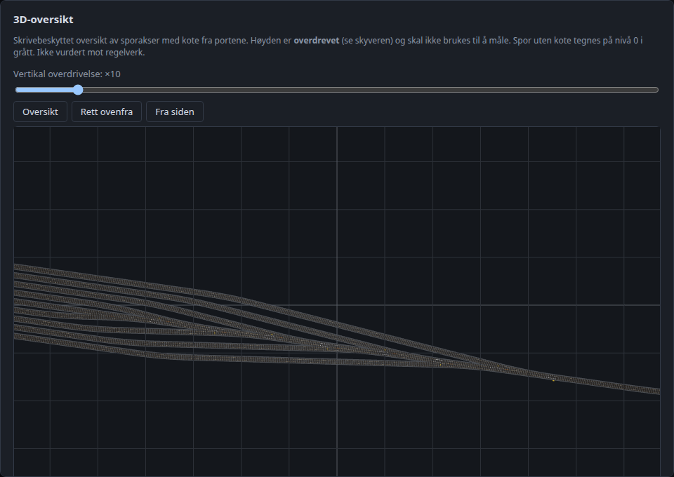

# RailCAD

[](https://github.com/Visionxxx/RailCAD/actions/workflows/ci.yml)
[](LICENSE)


**Parametrisk 2D-CAD for jernbanespor som kjører lokalt i nettleseren – uten server, uten innlogging.** Tegn spor (rette og sirkelkurver), koble dem topologisk, sett inn sporveksler, kryss og kryssveksler, legg inn høyder, mål, importer kart som bakgrunn, se anlegget i 3D og eksporter til DXF.

> **English:** RailCAD is a browser-based parametric 2D CAD sketching tool for railway track layouts (tracks, turnouts, crossings, elevations, DXF export, 3D overview). It runs entirely client-side (Vue 3 + TypeScript). It is an early sketching tool: **nothing is checked against regulations, and turnout data is only partly verified** – see the disclaimer below. UI and docs are in Norwegian (bokmål).



> **Viktig – les dette først:** RailCAD er et **skisse- og geometriverktøy**, ikke et prosjekteringsverktøy. Ingenting er kontrollert mot regelverk (Bane NOR/TRV m.fl.), sporveksler er bare **delvis verifisert**, og alt du selv definerer er **«ikke verifisert»**. Ikke bruk resultatene som underlag for bygging eller godkjenning uten uavhengig faglig kontroll. Se [NOTICE.md](NOTICE.md).

## Om prosjektet

RailCAD er utviklet i små, testede steg. Geometrien regnes av en ren TypeScript-motor bak et stabilt grensesnitt (`GeometryEngine`), og prosjekter lagres som lesbar JSON ([filformat](docs/filformat.md)). Alt som ikke er verifisert merkes som uverifisert – i grensesnittet, i DXF-filer og i dokumentasjonen.

|  |      |
| ------------------------------------------ | -------------------------------------------- |
| Vekseleditor med live forhåndsvisning      | 3D-oversikt med sporbunn, sviller og skinner |

## Status

| Område                                                                                            | Status                                                              |
| ------------------------------------------------------------------------------------------------- | ------------------------------------------------------------------- |
| Tegne/redigere spor (rett, kurve, parallell), snapping, mål, angre/gjør om, lag, kopiér/lim inn   | Ferdig og testet                                                    |
| Topologi (koblinger, toleransekontroll), kryssende spor-advarsel                                  | Ferdig (tangenttoleranse er en **foreløpig testverdi**)             |
| Sporveksler (3 TRV-typer), sporkryss, kryssveksel, sovitet sporkryss                              | Fungerer; veksler **delvis verifisert**, resten **ikke verifisert** |
| Vekseleditor (egne typer, tresporsveksel, hovedmål A–F), forhåndsinnstillinger, delbart bibliotek | Fungerer; alt brukerdefinert                                        |
| Høyder (kote per port), lengdeprofil, automatisk planskilt                                        | Fungerer                                                            |
| Kjøretøykontroll (utsving, sporavstand) med egne mål                                              | Fungerer; **ikke** regelverkskontroll                               |
| DXF-eksport (R12/R2007), bakgrunn (DXF/PDF/PNG/JPEG)                                              | Fungerer; **ikke testet i AutoCAD/andre CAD-program**               |
| 3D-oversikt (skrivebeskyttet, klikk for info)                                                     | Fungerer; vekseldeler er **illustrative**                           |

Tester: 240 enhetstester og 77 e2e-tester (Chromium; Firefox valgfritt).

## Hva som mangler

- **Regelverkskontroll (RC-014):** ingen kontroll mot Bane NOR/TRV eller andre krav. Programmet viser alltid «ikke vurdert».
- **Verifiserte vekselmål:** biblioteket har 3 typer, avledet fra TRV-hovedmål (ikke KO-tegninger). Ingen åpne norske mål for kryss/kryssveksler finnes i systemet. Ekte vekselmekanikk (tunger, hjerte, ledeskinner) i 3D er illustrasjon med generiske mål.
- **Testing utenfor utviklingsmiljøet:** DXF er bare verifisert med ezdxf; Safari/WebKit er ikke testet; ytelse med svært store anlegg er ikke målt utover 5 000 spor. Se [testsjekkliste](docs/testsjekkliste.md).
- **Ikke i omfang ennå:** georeferering/koordinatsystemer (kun lokalt XY), klotoider, vertikalkurver, redigerbar 3D, flere sider fra PDF, parametriske sammenhenger mellom spor (kopier er uavhengige).
- Flere kjente begrensninger: [se nedenfor](#kjente-begrensninger).

## Bidra

Bidrag og tilbakemeldinger er velkomne – særlig **kontrollerte vekselmål med kilde**, feilrapporter med eksempelfiler og testing i andre nettlesere/CAD-program. Se [CONTRIBUTING.md](CONTRIBUTING.md). Sikkerhetsfunn: [SECURITY.md](SECURITY.md). Drift og distribusjon: [docs/distribusjon.md](docs/distribusjon.md).

## Lisens

[MIT](LICENSE) for koden. Data og kilder (bl.a. Bane NOR TRV) har egne rettigheter – se [NOTICE.md](NOTICE.md).

## Installasjon og oppstart

Krever Node.js ≥ 20 (testet med Node 24, npm 11).

```bash
npm install
npm run dev          # http://localhost:5173
```

| Kommando                                                          | Hva den gjør                                     |
| ----------------------------------------------------------------- | ------------------------------------------------ |
| `npm run dev`                                                     | Utviklingsserver                                 |
| `npm run build` / `npm run preview`                               | Typesjekk + produksjonsbygg / forhåndsvis bygget |
| `npm test`                                                        | Enhetstester (Vitest)                            |
| `npx playwright install chromium` (én gang) og `npm run test:e2e` | Ende-til-ende-tester (starter dev-serveren selv) |
| `npm run typecheck`                                               | `vue-tsc` over hele arbeidsområdet               |
| `npm run lint` / `npm run format`                                 | ESLint / Prettier                                |

Ingen hemmeligheter eller miljøvariabler er nødvendige. Alt kjører lokalt, og ingen data forlater nettleseren.

## Bruk

Åpne **Fil → Åpne eksempelprosjekt** for tre parallelle spor på 140 m, en kurve og to mål, eller **Åpne avansert eksempel** for et sporfelt med 8 veksler, 35 koblinger og vifteformet veksellest. Det er en illustrasjon – ikke en faktisk anleggsgeometri.

| Verktøy (hurtigtast) | Slik bruker du det                                                                                                                                                              |
| -------------------- | ------------------------------------------------------------------------------------------------------------------------------------------------------------------------------- |
| Marker (V)           | Klikk velger, Shift+klikk flervalg. Dra objekt for å flytte; dra endepunktgrepene for direkte redigering. Esc avbryter/fjerner valg.                                            |
| Panorer (H)          | Dra. Midtknapp, eller Mellomrom + dra, panorerer også i alle andre verktøy. Musehjul zoomer rundt markøren.                                                                     |
| Rett spor (L)        | Klikk start- og sluttpunkt, **eller** fyll ut skjemaet (X, Y, retning, lengde) over tegneflaten og trykk Opprett.                                                               |
| Sirkelkurve (C)      | Klikk start (starter du i et sporendepunkt fortsetter buen tangentielt), klikk evt. tangentretning, klikk sluttpunkt. Eller bruk skjemaet (radius, venstre/høyre, sveipvinkel). |
| Parallelt spor (P)   | Sett sporavstand og side i verktøylinjen, klikk et rett referansespor og klikk for å plassere. Kopien er **uavhengig** av referansen.                                           |
| Roter (R)            | Valgte objekter: klikk pivot, referanseretning og ny retning – eller skriv vinkel (grader, mot klokka).                                                                         |
| Mål lengde (M)       | Klikk et spor, klikk for å plassere målelinjen. Måltallet er knyttet til sporet og oppdateres automatisk.                                                                       |
| Mål avstand (D)      | Klikk to punkter (med snapping) og plasser målelinjen. Lagres med egne koordinater.                                                                                             |
| Slett (E)            | Klikk objekt. Del-tasten sletter valgte. Tilknyttede lengdemål slettes med; Angre gjenoppretter alt.                                                                            |

Andre hurtigtaster: `Ctrl+Z` angre, `Ctrl+Y`/`Ctrl+Shift+Z` gjør om (200 trinn), `Ctrl+S` lagre, `Ctrl+O` åpne, `F` tilpass visning, `Enter` bekrefter parallelt spor.

**Kryssende spor:** programmet markerer der spor krysser, ender på eller overlapper hverandre uten kryss/veksel (gult kryss på tegneflaten og i **Kontroll → Kryssende spor**). Status er «ikke vurdert»; «Planskilt» bekrefter en bevisst kryssing i ulik høyde. Se `docs/kryssing.md`.

**Kopiér/lim inn, lås og lag:** `Ctrl+C`/`Ctrl+V` kopierer og limer inn (ved markøren; nye ID-er, koblinger mellom limte objekter og lengdemål følger med, ett angretrinn), `Ctrl+D` dupliserer. **Lås** et objekt i egenskapspanelet (eller et helt lag): det kan velges, men ikke flyttes, redigeres eller slettes. **Lag** (fanen Objekter): synlighet, lås, aktivt lag for nye objekter, flytting av valgte til lag; lag skrives også til DXF (`RAILCAD_SPORAKSE_<LAGNAVN>`). Prosjektnavnet endres ved dobbeltklikk på tittelen.

**Høyder og planskilt:** sett **kote** per port i egenskapspanelet (tomt = ukjent). Koblede porter deler kote; stigning og **lengdeprofil** langs sporkjeden vises. Setter du **minste fri høyde** i Prosjektinnstillinger (ingen standardverdi), avgjøres planskilte kryssinger automatisk ut fra høydeforskjellen (Δh vises i kontrollfanen). Kote-konflikter ved koblinger varsles.

**Egne veksler og kryss:** **Fil → Veksler og kryss (editor)** lar deg definere veksltyper (enkel, tresporsveksel, symmetrisk – med radius/1:n eller TRV-lignende hovedmål A–F) og forhåndsinnstillinger for sporkryss/kryssveksel, med live forhåndsvisning. Alt er «brukerdefinert – ikke verifisert». Typene lagres i prosjektfilen og kan deles som bibliotekfil (Fil → Importer/Eksporter vekselbibliotek). Se `docs/vekseleditor.md`. Drift/distribusjon: `docs/distribusjon.md`. Test med egne filer og eget CAD-program: `docs/testsjekkliste.md`.

**3D-oversikt:** Visning → 3D-oversikt viser sporene som en skjematisk **sporbygning**: sporbunn (singel), sviller (0,6 m) og to skinner per akse (sporvidde 1,435 m) – ikke overbygningsprosjektering; skinnehodet er tegnet litt bredere enn virkeligheten. **Veksler** vises med illustrativ mekanikk: tunger (6 m), hjerte, ledeskinner, stillverk, stagstenger og vekselsviller (svillefelt som dekker alle spor, delt når sporene ligger langt fra hverandre). Delene utledes av aksene med generiske proporsjoner – **ikke produktgeometri**, og hjertets plassering følger akseskjæringen i modellen, ikke en leverandørtegning. Kote fra portene gir høyden. Dra = roter, høyreknapp = flytt, hjul = zoom; knapper for Oversikt / Rett ovenfra / Fra siden. **Klikk på en skinne eller sporbunn** viser objektinfo (type, lengde/radius, status, kote per port, stigning); skrivebeskyttet. Skyver for **vertikal overdrivelse** (standard ×10) – ikke egnet til måling. Spor uten kote tegnes i avvikende farge på nivå 0. `three` lastes først når oversikten åpnes.

**Kjøretøykontroll (RC-015):** sett dine egne kjøretøymål i Prosjektinnstillinger (lengde, boggiavstand, bredde, sideklaring per side – ingen standardverdier). Under **Kontroll → Kjøretøykontroll** beregnes utsving i hver sirkelkurve (innover δi = R − √(R² − (B/2)²), utover δo = √((B/2+O)² + R² − (B/2)²) − R) og avstanden mellom nabospor (1–15 m) mot nødvendig senteravstand (bredde + 2 × klaring + utsving for begge spor ved nærmeste punkt). Alltid «ikke vurdert mot regelverk»: ingen kantsteg, overhøyde, vertikalkurver eller regelverkskrav.

**Å bli fort kjent:** i et tomt prosjekt vises et «Kom i gang»-kort (eksempler, åpne fil, import, hjelp). **Hjelp → Hurtigtaster og tips** (eller `?`) viser alle snarveier. Angre/gjør om og zoom/tilpass har egne knapper.

**Valg og tegning:** dra på tom flate for _valgboks_ (mot høyre: helt innenfor, mot venstre: alt som berøres, Skift legger til). Hold **Skift** mens du tegner et rett spor for å låse retningen til 15°. Pil opp/ned i tallfelt justerer verdien (Skift ×10, Alt ×0,1). Objekter opprettet via skjema utenfor skjermen blir vist automatisk.

**Sikkerhetskopi:** ulagret arbeid kopieres automatisk til nettleserens lokale lagring (ca. 1,5 s etter hver endring; ikke for svært store prosjekter) og tilbys gjenopprettet ved neste oppstart. Det erstatter ikke lagring – bruk Fil → Lagre.

**Snapping** (bunnlinjen, kan slås av/på): endepunkt, senter, tangent (fra forrige punkt), nærmeste punkt og rutenett. Søkeradius er 12 px og omregnes til meter – den påvirker aldri modellen. Merket vises ved markøren.

**Høyre panel** har fire faner: _Egenskaper_, _Objekter_, _Koblinger_ og _Bakgrunn_. Fanene viser antall (rødt merke på Koblinger ved avvik), kan betjenes med piltaster, og valgt fane huskes. Å velge et objekt (på tegneflaten eller i listen) viser egenskapene; i fanene Koblinger og Bakgrunn blir du værende.

**Egenskapspanelet** redigerer geometrien direkte (start, retning, lengde / radius, kurveretning, sveipvinkel, buelengde). Tall kan skrives med komma eller punktum; ugyldige verdier gir en feilmelding og endrer ingenting. **Visning → Skjematisk skinne-/svillevisning** tegner to skinner (1,435 m, kun skjematisk) og sviller ved høy zoom.

**Topologi:** Koblinger lagres eksplisitt i prosjektfilen (`connections`) og kontrolleres mot toleranser (posisjon `1 µm`, tangent foreløpig `1e-6` rad). Avvik rapporteres, ingenting flyttes automatisk.

**DXF-eksport:** Fil → Eksporter DXF (R12 eller R2007) – se `docs/dxf.md`. Lag for sporakser, sporveksler, mål og tekst; meter som enhet.

**Bakgrunn:** Fil → Importer bakgrunn (DXF, PDF, PNG, JPEG) – referanse under planen, med skalering ved to punkter, flytting, dekkevne og synlighet. Se `docs/bakgrunn.md`.

**Lagring:** Fil → Lagre laster ned `<prosjektnavn>.railcad.json`. Åpne leser filen tilbake og validerer den (struktur, tall, invarianter, unike ID-er, referanser) før noe vises; ved feil forklares det hva som er galt og prosjektet er urørt.

## Arkitektur

```
packages/
  domain/         Typer, JSON-skjema (zod), validering, migrering, ID-generering
  geometry-api/   Stabilt GeometryEngine-grensesnitt + eksplisitte toleranser
  geometry-ts/    TypeScript-implementasjon: linje, bue, offset, rotasjon, snapping, mål, topologi, sporveksler
  dxf/            DXF-eksport (R12, R2007) og DXF-lesing for bakgrunn
apps/web/src/
  commands/       Patch-modell og rene builders (opprett, erstatt, slett, flytt/roter)
  stores/         Pinia: project (modell + angre/gjør om), view (utsnitt/snap), ui
  tools/          Verktøy (Marker, tegning, parallell, mål, roter, slett) + controller
  rendering/      world↔screen, rutenett, SVG-stier
  components/     Meny, verktøylinje, tegneflate, egenskaper, objektliste, status
fixtures/         Eksempelprosjekter (tre spor; illustrasjon sporfelt – generert av scripts/generate-sporfelt.ts)
scripts/          Generatorer for eksempler og testfiler (generate-sporfelt, generate-dxf-samples, generate-background-samples)
tests/e2e/        Playwright
docs/             Filformat, DXF, bakgrunn, kryss, vekseleditor, distribusjon, testsjekkliste
```

Prinsipper:

- **Modell først.** Geometri lagres som parametere i meter/radianer. Skjermkoordinater finnes bare i `rendering/` og i pekerhendelser. Zoom/pan endrer aldri modellen.
- **Ren geometrimotor.** Vue-maler regner ikke faggeometri. Alt går via `GeometryEngine` (`apps/web/src/engine.ts` er eneste bindingspunkt, slik at Rust/WASM kan settes inn senere).
- **Angre/gjør om som data.** Hver redigering er en `Patch` (før/etter + posisjon) – deterministisk å reversere.
- **Geometri ≠ topologi.** Filformatet har `connections`; MVP oppretter ingen (P1), men validerer og bevarer dem.
- **Eksplisitte toleranser:** `TOLERANCES` i `geometry-api`.

Se `docs/` for filformat og detaljer.

## Kjente begrensninger

- **Ikke regelverkskontrollert.** Ingen kontroller mot Bane NOR/TRV. Panelet viser «ikke vurdert»; ingenting presenteres som godkjent.
- **Sporveksler er delvis verifisert** (3 typer, akser avledet fra TRV-hovedmål, ikke kontrollert mot KO-tegning – se `docs/vekseldata-trv.md`). Sporsløyfer og EVB-typer er ikke lagt inn i biblioteket; egne typer kan lages i vekseleditoren (brukerdefinert, ikke verifisert).
- **Tangenttoleranse for koblinger er en foreløpig testverdi.**
- **DXF-eksport er ikke testet i AutoCAD** (kun ezdxf og egne tester); måltall eksporteres som tekst.
- **Bakgrunn:** bare side 1 av PDF, ingen georeferering, DXF uten HATCH/DIMENSION.
- **Ingen klotoider, vertikalkurver eller redigerbar 3D (3D er kun oversikt)** (P1/P2 eller eksplisitt utelatt).
- **Sporkryss** er brukerdefinert (to rette akser, vinkel atan(1/n), lengde angitt av deg) og alltid «ikke verifisert». Kryssveksel og sovitet sporkryss er brukerdefinert (se `docs/sporkryss-sovitet.md`).
- Parallellføring støtter kun **rette** spor. Kopien er en uavhengig kopi (ingen parametrisk kobling).
- Lokalt XY-system. Svært store koordinater (f.eks. UTM ~6 000 000 m) er ikke testet i visningen og bør løses sammen med georeferering.
- Mål: «Mål avstand» er punkt-til-punkt. Vinkelrett sporavstand må settes via endepunkter/snapping; egen funksjon kan komme i P1.
- Mellomrom som panoreringstast virker ikke mens en knapp har tastaturfokus (den aktiverer da knappen).
- Skinne-/svillevisning er skjematisk (sporvidde 1,435 m, sviller visualisert som mønster), ikke overbygningsprosjektering.
- Ytelse: tegnet og testet med 5 000 spor (utsnittskulling; ca. 20–40 ms per zoomsteg i testmiljøet). Objektlisten tegner alle rader.
- Lagring skjer som nedlastet fil. Automatisk sikkerhetskopi i nettleseren (kladd) beskytter mot tap ved oppdatering/krasj, men kan utebli for svært store prosjekter eller hvis nettleseren blokkerer lokal lagring.

## Neste steg

Gjort: MVP, P1 (topologi, sporveksler, DXF, bakgrunn), kryss/kryssveksel/sovitet sporkryss, høyder og planskilt, vekseleditor og bibliotek, 3D-oversikt og kjøretøykontroll. Gjenstår, og krever data eller beslutninger utenfra:

1. **Verifiserte vekselmål** fra KO-tegninger og leverandørdata (krever henvendelse til Bane NOR og leverandører).
2. **Regelverkskontroll (RC-014)** – krever avklaring av hvilke krav som skal kontrolleres.
3. **Test med egne filer og eget CAD-program** (`docs/testsjekkliste.md`), og Safari/WebKit.
4. Georeferering, klotoider og vertikalkurver (ikke i omfang så langt).
